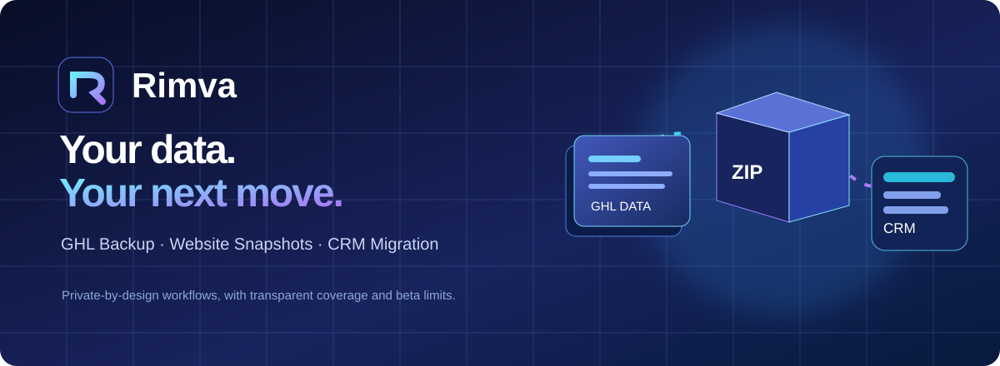
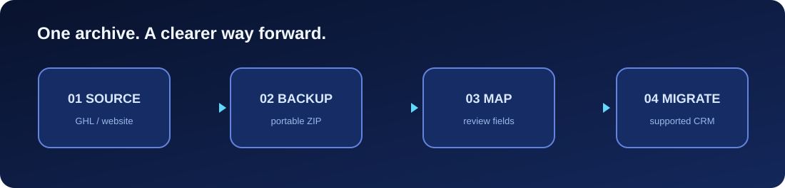
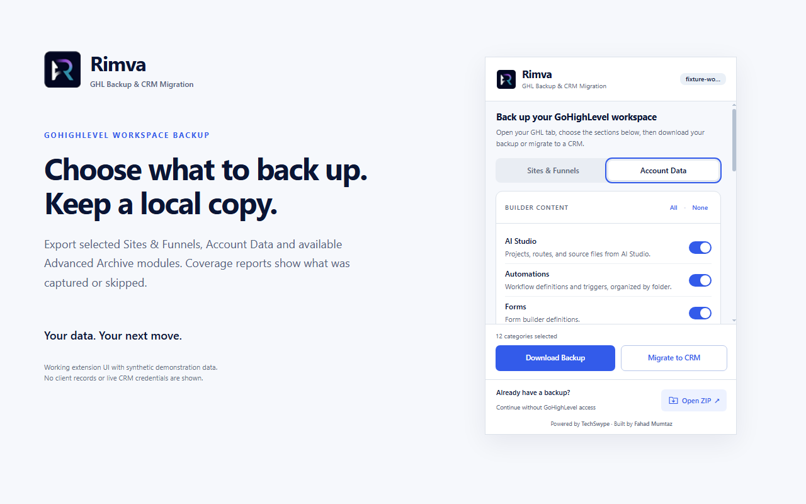
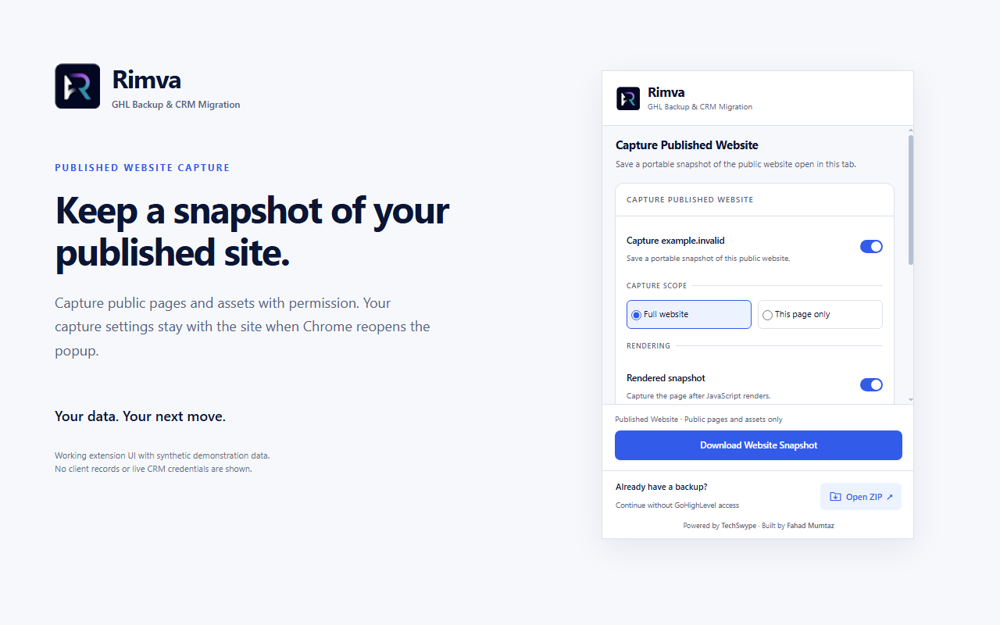
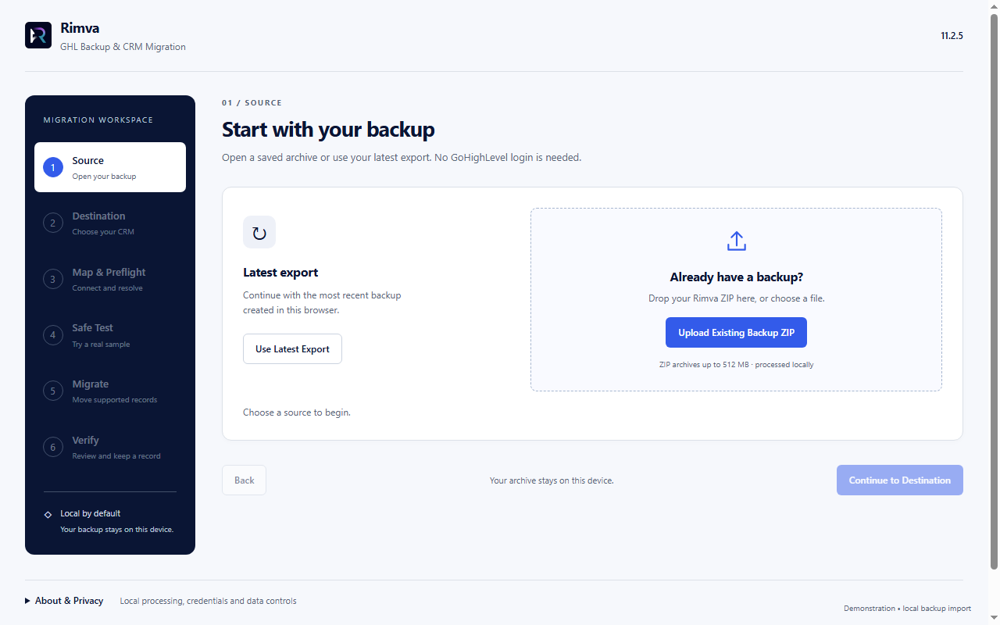
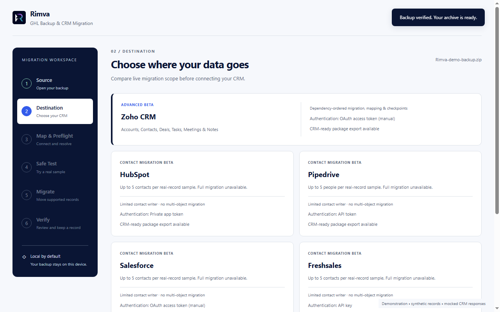
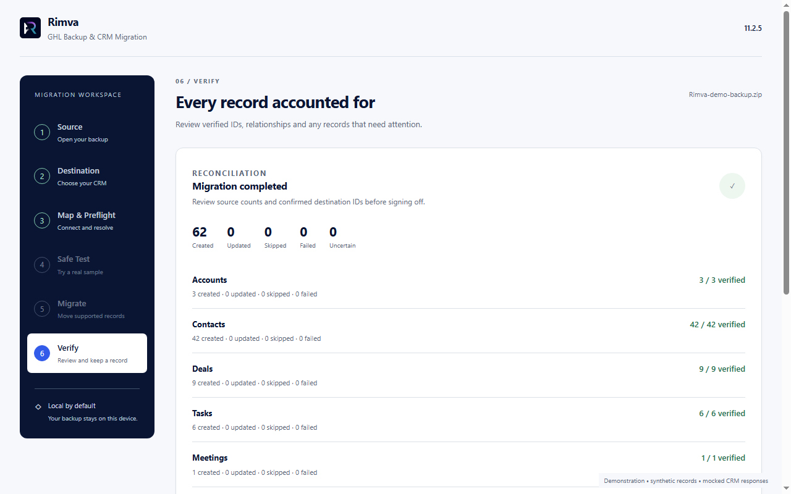

# Rimva — GHL Backup & CRM Migration

**Your data. Your next move.**

[Privacy policy website](https://fahad-mumtaz.github.io/rimva-privacy/) · [TechSwype](https://techswype.com/) · [Developer](https://www.linkedin.com/in/fahad-mumtaz-dev/)

## Product overview

Rimva is a Chrome extension built to help authorized GoHighLevel users **export selected workspace data**, **capture published websites**, and **open compatible backup ZIPs later** to prepare or run supported CRM migrations.

> **Scope and transparency:** Rimva is not a universal GHL restore tool. Export coverage depends on source permissions/APIs; some destination integrations are beta or limited.

### Core capabilities

| Workflow | What it does |
| --- | --- |
| **GHL workspace backup** | Select Sites & Funnels, Account Data and available Advanced Archive categories; download an archive and review captured/skipped/limited items. |
| **Published website snapshot** | Capture public HTML/pages and available assets with optional site permissions and configurable discovery/page limits. |
| **Offline ZIP import** | Open compatible saved Rimva or legacy Migravanta archives without having the original GHL session open. |
| **CRM staging packages** | Prepare destination-oriented CSVs with field/relationship guidance for manual review and import. |
| **Supported CRM migration** | Map data, test, authorize writes and review reconciliation/ledgers where provider adapters support them. |

## CRM migration support

| CRM | Current scope |
| --- | --- |
| **Zoho CRM** | **Advanced Beta** — Accounts, Contacts, Deals, Tasks, Meetings and Notes; mapping, checkpoints, and reporting. |
| **HubSpot** | Contact Migration Beta — up to five contact sample writes; no full multi-object migration. |
| **Pipedrive** | Contact Migration Beta — up to five person sample writes; no full multi-object migration. |
| **Salesforce** | Contact Migration Beta — up to five contact sample writes; no full multi-object migration. |
| **Freshsales** | Contact Migration Beta — up to five contact sample writes; no full multi-object migration. |

The available 11.2.5 verification includes automated regression tests and browser tests with mock destination APIs. **That does not certify production CRM migration.** Run your own preflight and representative sandbox test before migrating real business records.

## Privacy-first architecture

- User-requested backup ZIPs and reports are downloaded to your device.
- Local caches, field mappings and checkpoints may remain in extension storage until cleared.
- Destination credentials entered for migration are handled in tab memory in the reviewed build.
- Authorized destination transfers go directly to your chosen CRM API.
- Downloaded archives and local caches are **not automatically encrypted** by the extension.
- Site permissions and optional cross-domain asset access are feature-scoped and user-controlled.

Read the full [Rimva Privacy Policy](https://fahad-mumtaz.github.io/rimva-privacy/).

## Real extension screenshots · v11.2.5

These are **actual screens** captured from the Rimva 11.2.5 extension with synthetic demonstration data. They are not AI-generated interface mockups. All five images below are the **original 1280 × 800 PNG screenshots** from the Rimva v11.2.5 submission materials, uploaded without thumbnail downscaling. They use synthetic demonstration data; the migration verification example uses mocked destination API responses.

### 01 · GoHighLevel backup
Select Sites & Funnels, Account Data, and supported archive modules before downloading a backup.

### 02 · Published website capture
Capture a selected public website or page, including available rendered content and assets.

### 03 · Import a saved ZIP
Open compatible Rimva and legacy backup archives without requiring an active GoHighLevel session.

### 04 · Choose destination CRM
Review adapter support and beta limitations before selecting a migration destination.

### 05 · Reconciliation report
Review migrated, skipped, and failed records. **This screenshot uses synthetic data and mocked destination API responses; it is not proof of a completed live production migration.**

---

## About this repository

This public repository hosts Rimva's privacy notice using GitHub Pages. It is **not** the source repository for the browser extension, and does not include private account data, tokens, or customer backup files.

Built by **[Fahad Mumtaz](https://www.linkedin.com/in/fahad-mumtaz-dev/)** · Powered by **[TechSwype](https://techswype.com/)**

---
Rimva is an independently developed product. GoHighLevel and the named CRM platforms are trademarks of their respective owners; mentioning them does not imply endorsement or affiliation.
